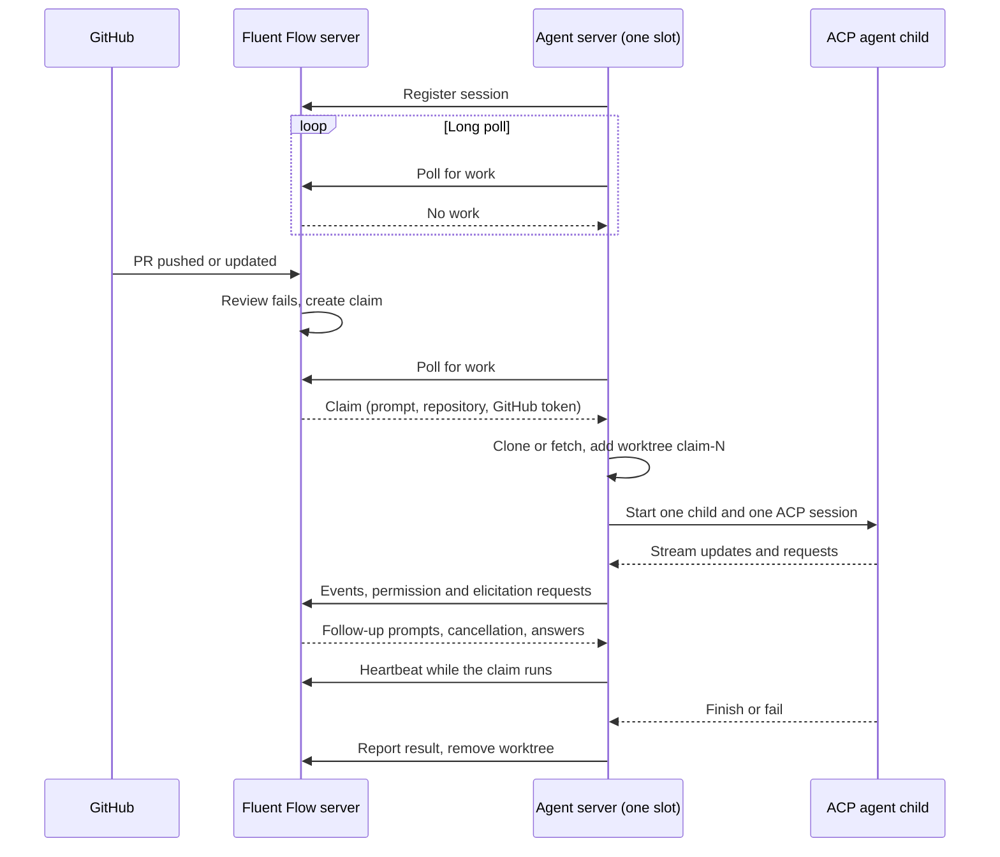

# fluent-flow-agent-server

[Project README](../../README.md) · [Server](../fluent-flow/README.md) · [Dashboard](../dashboard/README.md) · [Design](../../docs/superpowers/specs/2026-11-08-portable-agent-server-design.md)

The agent server runs Fluent Flow claims on a machine you control. It connects outward to the Fluent Flow server, takes pending claims (reviews, fixes, specs, builds, deterministic verification), runs each one in an isolated Git worktree with a local ACP agent (Claude Code or Codex), and reports the result. It needs no inbound port.

One process runs up to `--capacity` claims at once, 2 by default and 16 at most. Each slot has its own control-plane session and runs one claim and one ACP child at a time. A server belongs to one organization and one provider.

## Contents

- [What it does](#what-it-does)
- [Quick start](#quick-start)
- [CLI and environment reference](#cli-and-environment-reference)
- [Credentials and enrollment](#credentials-and-enrollment)
- [Provider credentials](#provider-credentials)
- [Capacity and slots](#capacity-and-slots)
- [Health and status](#health-and-status)
- [Startup checks](#startup-checks)
- [Platform support](#platform-support)
- [Security model](#security-model)
- [Operations](#operations)
- [Troubleshooting](#troubleshooting)
- [Development](#development)
- [Paseo connector](#paseo-connector)
- [Related documents](#related-documents)

## What it does



A slot works through these steps:

1. Register an ephemeral session and poll for work. The control plane hands out each claim to exactly one session.
2. Prepare the repository: clone or fetch the shared base clone, then add a detached worktree named `claim-<claim id>`. A per-repository lock covers clone, fetch, worktree add and prune, and is released before the agent starts.
3. Start one ACP v2 child and one session in that worktree, then send the claim prompt. Streaming updates, permission requests, elicitation requests and follow-up commands from the dashboard flow through the control plane.
4. Heartbeat while the claim runs. If the heartbeat answers `claim: null`, the control plane no longer assigns the claim to this slot (cancelled, expired or completed elsewhere). The slot cancels the child, removes the worktree and reports nothing for that claim.
5. Report the result once the session goes idle or fails, close the child, remove the worktree and poll again.

Each pipeline phase is a separate claim, so any server with free capacity can run the next phase.

Verification claims come in two phases. Red verification uses the configured ACP agent to write requirement tests at the reviewed commit. The server copies only validated test-scope artifacts into a separate checkout of that commit, requires every declared test file to report results in both reproductions, records the artifact hashes and publishes the red artifact commit. Green verification starts no model: it checks the server-owned hashes, requires results from every pinned test file and runs the full suite. A branch move or publication failure fails the claim transiently. Deterministic subprocesses use argv execution without a shell.

All ACP children are spawned with `shell: false`. Prompts and service data are protocol messages, never command text. The control plane never supplies an executable, arguments or environment to the agent server.

## Quick start

Create the server in the dashboard first: Agents, **+ New agent server**. Choose the provider, a capacity from 1 to 16 and the deployment. The dashboard shows one command that carries a single-use enrollment token valid for 15 minutes. The dialog reads Connected when a slot comes online.

### Local

Local mode reuses the login of your provider CLI. You need:

- Node 20 or newer, `git` and `gh` on `PATH`. `gh` does not need to be logged in.
- A signed-in provider CLI (Claude Code or Codex) on this machine.
- The ACP adapter for your provider: `npm install -g @agentclientprotocol/claude-agent-acp` or `npm install -g @agentclientprotocol/codex-acp`.

Run the generated command:

```bash
npx @fluent-flow/agent-server@latest \
  --server https://flow.example.com \
  --provider claude-code \
  --capacity 2 \
  --enrollment-token enroll_<64 hex characters>
```

State goes to `~/.fluent-flow/agent-server` and clones and worktrees to `.fluent-flow/work` under the current directory. Pass `--state-dir` and `--work-dir` to move them. The agent runs with your user's file access, so a local server is exactly as powerful as running the provider CLI yourself. The worktree is a working directory, not a sandbox.

To run from a checkout instead of npm:

```bash
node packages/fluent-flow-agent-server/bin/fluent-flow-agent-server.js \
  --server http://127.0.0.1:3847 --provider claude-code --enrollment-token enroll_<64 hex characters>
```

### Self-hosted (Docker)

The image `ghcr.io/fluent-io/fluent-flow-agent-server` contains Git, the GitHub CLI and the pinned Claude and Codex adapters, so the host needs only Docker and a provider secret file. It runs as UID 1000. Put the credential in a file that UID 1000 can read (see [Provider credentials](#provider-credentials) for the contents):

```bash
sudo install -d -m 0755 /etc/fluent-flow
sudo install -o 1000 -g 1000 -m 0400 ./provider-auth /etc/fluent-flow/provider-auth
```

Then run the command from the dashboard:

```bash
docker run -d \
  --name fluent-flow-agent-server \
  --restart unless-stopped \
  --init \
  -v /etc/fluent-flow/provider-auth:/run/secrets/provider-auth:ro \
  -v fluent-flow-state:/home/node/.fluent-flow \
  -v fluent-flow-work:/work \
  ghcr.io/fluent-io/fluent-flow-agent-server:latest \
  --server https://flow.example.com \
  --provider claude-code \
  --capacity 2 \
  --deployment self_hosted \
  --enrollment-token enroll_<64 hex characters> \
  --provider-secret-file /run/secrets/provider-auth
```

The state volume holds the durable token that the enrollment exchange returns. Keep it when you recreate the container.

For a hardened setup use the Compose file in this package. It adds a read-only root filesystem, `cap_drop: ALL`, `no-new-privileges`, tmpfs for `/tmp` and `/home/node`, file-based secrets and no published ports:

```bash
export FLUENT_FLOW_SERVER=https://flow.example.com
export AGENT_PROVIDER=claude-code
export AGENT_CAPACITY=2
export FLUENT_FLOW_ENROLLMENT_TOKEN=enroll_<64 hex characters>
export PROVIDER_AUTH_FILE=/etc/fluent-flow/provider-auth
docker compose -f packages/fluent-flow-agent-server/docker-compose.yml up -d
```

`docker-compose.durable-token.yml` is the variant for a durable token file instead of enrollment. It needs `FLUENT_FLOW_TOKEN_SECRET_FILE` and does not use `FLUENT_FLOW_ENROLLMENT_TOKEN`. Details for both files are in [docker/README.md](docker/README.md).

### Hosted

Hosted deployments are run by the platform operator, who provisions one organization-scoped server per organization and provider. The dashboard shows hosted servers but has no button to create one. The operator creates the agent row and an `ff_` token scoped to that organization, mounts the token and the provider credential as read-only files and uses an HTTPS control-plane URL:

```bash
docker run -d \
  --name fluent-flow-agent-server \
  --restart unless-stopped \
  --init \
  -e FLUENT_FLOW_TOKEN_FILE=/run/secrets/fluent-flow-token \
  -v /etc/fluent-flow/token:/run/secrets/fluent-flow-token:ro \
  -v /etc/fluent-flow/provider-auth:/run/secrets/provider-auth:ro \
  -v fluent-flow-state:/home/node/.fluent-flow \
  -v fluent-flow-work:/work \
  ghcr.io/fluent-io/fluent-flow-agent-server:latest \
  --server https://flow.example.com \
  --provider claude-code \
  --capacity 2 \
  --deployment hosted \
  --provider-secret-file /run/secrets/provider-auth
```

The repository root `docker-compose.yml` has the same service behind the `hosted-agent` profile. It shares no network with Postgres and the default `docker compose up` does not start it:

```bash
export AGENT_SERVER_FLUENT_FLOW_URL=https://flow.example.com
export AGENT_SERVER_PROVIDER=claude-code
export AGENT_SERVER_PROVIDER_AUTH_FILE=/etc/fluent-flow/provider-auth
export AGENT_SERVER_TOKEN_FILE=/etc/fluent-flow/token
docker compose --profile hosted-agent up -d agent-server
```

`AGENT_SERVER_CAPACITY` (default 2) and `AGENT_SERVER_IMAGE_TAG` (default `latest`) are optional. For the default `self-hosted` organization the Admin API creates the agent and token (`POST /api/agents`, then `POST /api/agents/<id>/tokens`, both with the server's `MCP_AUTH_TOKEN`). Other organizations need the platform's own provisioning, because the Admin API only creates agents in the default organization.

## CLI and environment reference

Every option takes one value except `--acp-arg`, which can repeat. Unknown options fail startup.

| Option | Default | Validation |
|---|---|---|
| `--server` | required | HTTPS URL, or HTTP to `localhost`, `127.0.0.1` or `[::1]`. Credentials in the URL are rejected. |
| `--provider` | required | `claude-code` or `codex`. |
| `--deployment` | `local` | `local`, `self_hosted` or `hosted`. The last two require `--provider-secret-file`. Reported to the dashboard and does not change execution. |
| `--capacity` | `2` | Digits only, from 1 to 16. |
| `--enrollment-token` | none | Single-use `enroll_` token from the dashboard. Used only when there is no token file and no stored token. |
| `--provider-secret-file` | none | Required for `self_hosted` and `hosted`. At most 64 KiB, not empty after one trailing line ending is removed. For Codex it must parse as a JSON object. |
| `--work-dir` | `<current directory>/.fluent-flow/work` | Base clones and per-claim worktrees. |
| `--state-dir` | `~/.fluent-flow/agent-server` | Instance ID and durable token. Created with mode 0700 on Linux and macOS; see [Platform support](#platform-support) for Windows. |
| `--health-host` | `127.0.0.1` | Bind address of the status listener. |
| `--health-port` | `3860` | Integer from 1 to 65535. |
| `--acp-command` | none | One executable name or path, without whitespace or shell text. Replaces the built-in adapter for `--provider`. |
| `--execution-timeout-minutes` | `60` | Integer from 1 to 1440. Time limit for one claim's ACP execution. See [Capacity and slots](#capacity-and-slots). |
| `--acp-arg` | none | One literal argument for `--acp-command`. Repeat it for more. Requires `--acp-command`. |
| `FLUENT_FLOW_TOKEN_FILE` | none | Path to a durable `ff_` token. Wins over stored state and enrollment. |
| `FLUENT_FLOW_HEARTBEAT_MS` | `60000` | Claim heartbeat interval in milliseconds. The control plane extends the claim for 15 minutes on each heartbeat. |
| `FLUENT_FLOW_TOKEN` | rejected | Startup fails if this variable exists, even when empty. |
| `LOG_LEVEL` | `info` | `trace`, `debug`, `info`, `warn`, `error` or `fatal`. Any other value, including an empty one, fails startup. There is no command-line flag. |

Built-in adapters resolve to `claude-agent-acp` for `claude-code` and `codex-acp` for `codex`. When no `--acp-command` is set, every claim must name the same adapter as `--provider` (`claude-code` and `claude-agent-acp` are one adapter, `codex` and `codex-acp` another). A claim for the other adapter fails once as `failed` with `failure_kind: terminal`, before any worktree or ACP child exists, and logs `Claim agent type does not match the configured provider` without naming either adapter. With `--acp-command` the claim's agent type is not checked. A custom adapter must speak ACP v2:

```bash
fluent-flow-agent-server \
  --server https://flow.example.com \
  --provider codex \
  --acp-command /opt/adapters/my-acp \
  --acp-arg --profile \
  --acp-arg review
```

The old `--token`, `--cwd`, `--agent`, `--verbose` and `--command` options are gone.

## Credentials and enrollment

The server needs one durable `ff_` token for registration, polling, heartbeats and results. It finds it in this order:

1. The file named by `FLUENT_FLOW_TOKEN_FILE`. Trailing whitespace is trimmed. If nothing remains, startup fails.
2. The token stored in `state.json` in the state directory.
3. A one-time exchange of `--enrollment-token`.

The first source that exists wins, so an enrollment token passed next to a token file or a stored token is never sent.

Enrollment works like this:

- The dashboard creates the agent and an `enroll_` token in one transaction. The token is valid for 15 minutes and is shown once, inside the command.
- On first start the server sends the token and its instance ID to `POST /api/agent-server/enroll`. One database transaction locks the token, revokes it and issues a durable token labelled `instance:<instance id>`. The server writes that token to `state.json` before it creates any slot.
- A used, expired, revoked or unknown token gets the same `401`. After 10 attempts per minute from one network peer the control plane answers `429`.
- The enrollment token never reaches a child process. The durable token never reaches a child environment either, but see [the residual](#security-model).

On Linux and macOS the state directory is private: mode 0700, with `state.json` at 0600, written by atomic rename and fsync. The server refuses a symlinked or group-readable state file, malformed JSON or an invalid instance ID instead of repairing it. Windows has no mode bits and cannot fsync a directory, so there the server skips those two checks and keeps the rest: it still refuses symlinks, oversized, malformed or wrongly typed state, replaces the file atomically and publishes the first state exclusively. See [Platform support](#platform-support). The instance ID is a UUID that stays stable across restarts, so one process keeps its identity.

A durable token issued at enrollment expires after 365 days. When it does, registration fails with `Register failed: 401`. Create a new server in the dashboard, or regenerate the key on the agent detail page and supply it through `FLUENT_FLOW_TOKEN_FILE`. Regenerating revokes every active token of that agent. Operators with the server's `MCP_AUTH_TOKEN` can list and revoke tokens with `GET /api/agents/<id>/tokens` and `DELETE /api/agents/<id>/tokens/<token id>`.

## Provider credentials

| Mode | Where the login comes from |
|---|---|
| Local | The provider CLI login in your home directory. The server passes `HOME` to the child and nothing else from the provider. |
| Self-hosted and hosted | One file named by `--provider-secret-file`. |

The file holds only the selected provider's credential:

- Claude Code: the OAuth token value you would export as `CLAUDE_CODE_OAUTH_TOKEN`. One trailing line ending is removed.
- Codex: the Codex auth JSON document, a single JSON object. It reaches the child as `CODEX_AUTH_JSON`.

The server reads the file once at startup, rejects it above 64 KiB or when empty, and never copies it into the state or work directory. The process must be able to read it: in the container that is UID 1000, so use `chown 1000:1000` with mode 0400 or 0600 on the host, or `fsGroup: 1000` on Kubernetes and ECS volumes.

There is no API-key fallback. `ANTHROPIC_API_KEY`, `OPENAI_API_KEY` and any other variable in the host environment are not passed to the child, because the child environment is an allowlist. A server without a working subscription login fails its claims instead of billing an API key.

## Capacity and slots

Capacity is the number of slots, set with `--capacity`. Every slot registers its own control-plane session, so the dashboard shows `active slots / capacity` for a server. Slots share the durable token, the provider credential, the work directory and one base clone per repository. They do not share worktrees or ACP children: each claim gets `claim-<claim id>` and its own child.

With capacity 2, two claims run at once and a third stays pending until a slot is free. The control plane assigns a pending claim to one session only, so two slots never take the same claim. To change capacity, restart the server with a new `--capacity`. The dashboard takes the latest capacity from live sessions and falls back to the value chosen at creation.

A slot that crashes is restarted without disturbing the other slots, with a delay of 2 seconds that doubles to a cap of 60 seconds. A restarted slot that registers a session resets the delay. Shutdown cancels any pending wait and never restarts a slot.

Limits per claim:

- **Execution time.** Every claim stops after `--execution-timeout-minutes` (default 60), counted from the moment the slot accepts it. At the deadline the server cancels the ACP session if one is running, ends the child through the normal close path, aborts any deterministic verification command, removes the worktree and reports one `failed` result with `failure_kind: transient`, so the control plane redispatches the claim. It logs `Claim execution timed out` with the claim ID. A verification claim has one deadline for the whole claim, not one per authoring turn. Ownership loss and shutdown clear the deadline, and neither reports a second result. Deterministic verification phases also keep their own command timeouts.
- **Prompt size.** A resolved prompt larger than 131072 bytes (128 KiB, measured in UTF-8) fails the claim before any worktree or ACP child exists. The server reports one `failed` result with `failure_kind: terminal`, because redispatching cannot shrink the prompt, and logs `Claim prompt exceeds size limit` with the size and no prompt text. The cap covers verification authoring prompts too, and a verification claim over the cap fails before its worktree is created.
- **Verification settings.** The control plane's claim can carry `verification` settings. The server clamps them instead of trusting them: command timeouts `timeouts_min.red` and `timeouts_min.green` to 1 to 1440 minutes, `authoring.retries` to 0 to 10, `authoring.max_requirements` to 1 to 100, `authoring.red_reproductions` to 1 to 10 and `flake.retries` to 0 to 10. A value that is not a number falls back to its default.
- **Result text.** Collected result text is capped at 5 MiB.

The control plane expires a claim 15 minutes after the last heartbeat, and the slot stops heartbeating once it loses the claim. Each active claim runs its own provider process, so size the host for `--capacity` such processes at once.

## Health and status

The status listener binds to `127.0.0.1:3860` by default. Bind to `0.0.0.0` only on a private network.

```bash
curl -s http://127.0.0.1:3860/healthz
```

```json
{
  "status": "healthy",
  "instance_id": "7b1c4f56-2a0e-4c8b-9d3a-5e4f1a2b3c4d",
  "provider": "claude-code",
  "capacity": 2,
  "active": 1,
  "online_slots": 2
}
```

`/status` returns the same six fields. Other paths return 404, other methods 405 and a malformed request target 400.

A slot counts as online when it has a session, has not failed and has no consecutive poll failures. `active` counts online slots that hold a claim.

| Status | Condition | `/healthz` HTTP code |
|---|---|---|
| `healthy` | Every slot is online and no slot reports a failed worktree cleanup | 200 |
| `degraded` | At least one slot is online but not all, or all are online and a cleanup failed | 200 |
| `unhealthy` | No slot is online | 503 |

`/status` always answers 200 so you can read the body of an unhealthy server. The status says nothing about the provider login.

The image health check calls `/healthz` on `127.0.0.1:3860` every 30 seconds, with a 20 second start period.

Logs are [pino](https://getpino.io) JSON lines on standard output with a string `level`, `msg` and an ISO 8601 `time`, plus event fields. The `LOG_LEVEL` environment variable sets the minimum level (default `info`). The server writes no process ID or host name. Each slot logs through a child logger that adds `instanceId` and `slotId`. They carry claim IDs, repositories and decisions. They do not carry prompts, raw ACP content, provider credentials or GitHub tokens. Fields named `token`, `githubToken` or `authorization`, at the top level or one object down, are replaced with `[REDACTED]`. Messages and error text also pass through a redaction that replaces `ff_` and `enroll_` tokens, GitHub tokens (`ghp_`, `gho_`, `ghu_`, `ghs_`, `ghr_` and `github_pat_`), `Authorization: Basic` headers and provider credential assignments. Failure logs carry the claim ID and a redacted `reason`.

Decision events carry an `event` field:

| `msg` | `event` | Fields |
|---|---|---|
| `Agent server started` | `agent_server_started` | `instanceId`, `capacity`, `provider`, `deployment`, `version` |
| `Session registered`, `Session re-registered` | `slot_registered`, `slot_reregistered` | `instanceId`, `slotId`, `sessionId` |
| `Claim accepted` | `claim_accepted` | `claimId`, `repo`, `attempt` |
| `Claim reported` | `claim_reported` | `claimId`, `repo`, `attempt`, `status`, `failureKind` |
| `Failed to report claim` | `claim_report_failed` | `claimId`, `repo`, `attempt`, `reason` |
| `Claim execution timed out` | `claim_execution_timed_out` | `claimId`, `repo`, `attempt` |
| `Claim prompt exceeds size limit` | `claim_prompt_too_large` | `claimId`, `repo`, `attempt`, `promptBytes`, `limitBytes` |
| `Claim agent type does not match the configured provider` | `claim_provider_mismatch` | `claimId`, `repo`, `attempt` |
| `Stale worktrees cleaned` | `stale_worktrees_cleaned` | `repositories`, `removed`, `failed` |
| `Stale worktree cleanup failed` | `stale_worktree_cleanup_failed` | `repo`, `reason` |
| `Agent server slot failed` | `slot_restart_scheduled` | `instanceId`, `slotId`, `attempt`, `restartInMs`, `reason` |
| `Agent server shutdown complete` | `agent_server_shutdown_complete` | `instanceId` |

The ACP runtime reports no timeout or forced-kill event of its own, so the server logs none. Provider health transitions are not logged because the server has no provider probe.

## Startup checks

Before it opens the health listener or creates a slot, the server checks that `git`, `gh` and the ACP adapter executable exist on the child `PATH`. A missing tool stops startup with `Required tools are missing: <names>`. The check runs against the child environment, so a tool that only your login shell adds to `PATH` is not found.

Container and hosted modes also read and validate the provider secret file at startup: it must exist, be readable, stay under 64 KiB and have the right shape.

Two things are not verified at startup:

- Local mode does not check that your provider CLI is logged in. The first claim finds out: an ACP authentication failure is reported as a transient claim failure, and the control plane redispatches the claim. This gap is tracked as an open deviation in the [design](../../docs/superpowers/specs/2026-11-08-portable-agent-server-design.md#acceptance-status).
- In every mode the server does not test that the provider accepts the credential, that `gh` can reach GitHub or that the control plane accepts the token. Registration reports the token problem, the first claim reports the rest.

## Platform support

The agent server runs on Linux, macOS and Windows. The Fluent Flow control plane (`packages/fluent-flow`) runs on Linux only and is not covered here. The container image is Linux only.

How it is checked: the `acp-agent-server` job in `.github/workflows/ci.yml` runs the cross-platform unit tests and the typecheck on `ubuntu-latest`, `macos-latest` and `windows-latest`. Those tests that depend on the platform inject it (`platform: 'win32'`), so the Windows code paths also run on Linux and macOS. The in-process smoke and the image smoke run on Linux only.

What was not verified: none of the Windows behavior below has been run on a Windows machine by the author. The first Windows CI run is its first real execution.

What differs on Windows:

- State. No mode checks and no directory open or fsync (Windows cannot open a directory with `fs.open`, and NTFS reports 0666-style modes). A symlinked or junctioned state directory is refused by `lstat`. The file is still written to a temporary name and renamed over `state.json`; because the rename can fail with `EPERM`, `EBUSY` or `EACCES` while an antivirus scanner or another reader holds the file, it is retried up to 5 attempts with 10, 20, 40 and 80 ms pauses, and the last error is then thrown. First publication is still exclusive (a hard link, which needs NTFS). Privacy comes from the directory ACL: keep the default `%USERPROFILE%\.fluent-flow\agent-server`, or a directory only your account can read.
- Stopping. `SIGINT` (Ctrl+C) and `SIGBREAK` (Ctrl+Break) start a graceful shutdown. Windows does not deliver `SIGTERM`; `taskkill /F`, ending the task or stopping a service does not run the shutdown, and the claim is redispatched after the control plane's lease expires.
- Git. Claims run with `GIT_CONFIG_GLOBAL=NUL` and `core.longpaths=true`, because worktrees live under `<work dir>\.fluent-flow\repos\<owner>\<repo>\.worktrees\claim-<id>`. Other tools can still hit the 260-character limit unless Windows long paths are enabled. Keep `--work-dir` short.
- ACP adapters. The known adapters installed through npm are found through their `.cmd` shim and started as `node <entry>` with `shell: false`. A custom `--acp-command` must be a native executable: `.cmd` and `.bat` wrappers are rejected.
- Environment. The child environment keeps one spelling of each allowed variable, matched case-insensitively (`Path`, `SystemRoot`, `PATHEXT` and so on).

Known limits on Windows:

- Deterministic verification claims are not supported. The default test and install commands (`npm`, `pnpm`, `yarn`, `vitest`, `jest`) are `.cmd` shims, and verification runs argv without a shell, so they cannot be started.
- Review and fix prompts contain POSIX shell snippets (`/tmp`, here-documents). Whether they work depends on the shell the provider CLI uses on Windows.
- Provider CLIs that need `APPDATA`, `LOCALAPPDATA` or other variables that the environment allowlist does not pass may not find their login. The allowlist was not widened.
- ACP child processes are stopped individually; grandchildren are not terminated, on any platform.

## Security model

These controls limit what an agent working on a claim can reach. One residual remains, described after the list.

- ACP and verification children get an allowlisted environment: `PATH`, `HOME`, temp directories, locale and terminal basics, the selected provider credential and the claim's GitHub token. Fluent Flow tokens, database and cloud variables, other providers' keys, host Git configuration and SSH agent variables are excluded.
- Each claim carries a GitHub App installation token. Git receives it through an HTTPS extra header supplied in the child environment, and `gh` through `GH_TOKEN`. It appears in no command argument, remote URL, `.git/config` or commit metadata. Host global and system Git configuration is turned off, and commits use `Fluent Flow Agent <agent@fluentflow.invalid>`. Clones use HTTPS, so mounted SSH keys are not used, and an existing SSH origin is rewritten to the clean HTTPS URL.
- The stored remote is always `https://github.com/<owner>/<repo>.git`. Repository names must match `owner/repo` and claim IDs must be positive integers before they reach the filesystem or Git.
- `--server` must be HTTPS, with plain HTTP allowed only for loopback development. A plain HTTP URL on a private network is rejected.
- Errors that reach a user, logs, status responses and claim results exclude provider credentials, the enrollment token, the durable token and GitHub tokens. The smoke test scans all of them for planted secrets.
- Every `ff_` token belongs to one organization and one agent, and can be revoked.

The residual: ACP children run as the same operating-system user as the server. A child can therefore read the durable token file (`FLUENT_FLOW_TOKEN_FILE`) and `state.json` from disk even though neither is in its environment. A stolen token is limited to that agent in that organization and you revoke it from the dashboard or Admin API. In a container, mount the token read-only, keep it out of the work volume, and treat the whole container as the trust boundary for one organization. Local mode has the further limit that the agent has your full user access.

Enrollment tokens appear on the command line, so they show up in shell history, in the process list while the server runs and, with Docker, in `docker inspect` after the first start. They are useless once exchanged or after 15 minutes.

## Operations

Logs go to standard output. Read them with `docker logs fluent-flow-agent-server` or your process manager.

Stop the server with SIGTERM or SIGINT (Ctrl+C locally, `docker stop` in a container). It stops the health listener, cancels active ACP sessions, closes each child within bounded waits of 5 seconds per phase (idle, exit, kill), reports unfinished claims as transient failures, removes worktrees and exits 0. A second signal does not force an exit. It only marks the exit code 1 while the drain continues. A `docker stop` timeout shorter than the drain sends SIGKILL, and the control plane then recovers the claim when its 15 minute expiry passes. Raise the stop timeout (for example `docker stop --time 30`) when claims are likely to be active. The poll backoff wait is not interruptible, so during a control-plane outage a slot can take up to 60 seconds to notice the stop request.

The process itself is not supervised. Startup failures (bad options, missing tools, state or enrollment errors, a busy health port) log an error and exit with code 1. Run it under `--restart unless-stopped`, systemd or a Kubernetes controller so a crash comes back.

Volumes:

- `fluent-flow-state` (`/home/node/.fluent-flow`) holds the instance ID and durable token. Without it the server enrolls again, and a consumed enrollment token fails with `Enrollment failed: 401`. Create a new server in the dashboard to recover. With a token file or hosted token the loss costs nothing except stale sessions, which expire within five minutes.
- `fluent-flow-work` (`/work`) holds base clones and worktrees. Worktrees disappear after each claim. After a crash or kill, the next start removes leftover `claim-*` worktree directories under `/work/.fluent-flow/repos/*/*/.worktrees/` and runs `git worktree prune` in each base clone, before any slot starts, and logs the counts. A work directory that cannot be read stops startup. Base clones are a cache and you can delete them when the server is stopped.
- On Kubernetes or ECS mount both with `fsGroup: 1000` or equivalent so UID 1000 can write.

Other points:

- `docker compose down` interpolates the required variables, so set them (placeholder values work) or run it from the shell that started the stack.
- The image health check probes `127.0.0.1:3860` only. With a different `--health-host` or `--health-port`, add your own `healthcheck:` or `--health-cmd`, otherwise Docker reports the container unhealthy.
- The dashboard Docker command fixes the container name `fluent-flow-agent-server` and the volume names. A second server on the same host needs its own `--name` and volume names. Two servers on the same machine without containers need their own `--state-dir`, `--work-dir` and `--health-port`, and each needs its own server name in the dashboard.
- Upgrade by pulling a newer image and recreating the container with the same volumes. Pin `:<version>` to control when it changes. `latest` moves only after a verified release.
- The `FLUENT_FLOW_HEARTBEAT_MS` variable exists for tests and tuning. Leave it at the default in production.

### Releases

A GitHub release tagged `agent-server-v<version>` must match `package.json`. The workflow runs the tests, typecheck, in-process smoke, a tarball check and an amd64 image smoke before it publishes anything. The npm dist-tag is `next` for a prerelease, `latest` for a stable version at least as high as the highest stable version already published (and the current `latest` tag), and `legacy` for a lower stable version (a backport). That rule is [scripts/release-policy.mjs](../../scripts/release-policy.mjs) at the repository root, tested by `npm run test:release` in CI and before every release. The image is pushed as `:<version>` for amd64 and arm64, checked by digest (the full smoke on amd64, tool versions on arm64), and `:latest` moves to that digest only when the version qualifies for `latest`. An existing `:<version>` tag is verified and never overwritten. The workflow has not run on GitHub yet. See [docker/README.md](docker/README.md) for the image contents.

## Troubleshooting

Errors appear in the JSON log as `"error": "<text>"`. Search by the text.

| Error text | Cause and fix |
|---|---|
| `Unknown agent server option.` | An option that no longer exists (`--token`, `--cwd`, `--agent`, `--verbose`) or a typo. Use [the reference](#cli-and-environment-reference). |
| `Plaintext control-plane token environment variables are not supported.` | `FLUENT_FLOW_TOKEN` is set. Remove it and use `FLUENT_FLOW_TOKEN_FILE` or enrollment. |
| `Server URL must use HTTPS.` | `--server` is plain HTTP to a non-loopback host. Use HTTPS. |
| `Provider credentials are required for this deployment.` | `--deployment self_hosted` or `hosted` without `--provider-secret-file`. |
| `Invalid option: expected one of "claude-code"\|"codex"` | `--provider` is missing or misspelled (`opencode` is not a provider option). |
| `Too big: expected number to be <=16` or `--capacity requires an integer value.` | `--capacity` is outside 1 to 16 or not a whole number. |
| `Invalid input: expected string, received undefined` for `serverUrl` | `--server` is missing. |
| `<option> requires a value.` | An option is the last argument or is followed by another option. |
| `ACP arguments require an explicit local ACP command` | `--acp-arg` without `--acp-command`. |
| `Provider credential file is empty.` or `Provider credential file is too large.` | The secret file is empty or over 64 KiB. |
| `Codex provider credentials are invalid.` | The Codex secret file is not a JSON object. |
| `EACCES` or `ENOENT` on the provider secret path | The file is missing or UID 1000 cannot read it. Check the mount and `chown 1000:1000`. |
| `Required tools are missing: git, gh, claude-agent-acp` | The named tools are not on the child `PATH`. Install them. The image already has them. |
| `No durable credential or enrollment credential is available.` | No token file, no stored token and no `--enrollment-token`. Create a server in the dashboard. |
| `Enrollment failed: 401` | The enrollment token was used, expired, revoked or mistyped. Create a new server in the dashboard. |
| `Enrollment failed: 429` | More than 10 enrollment attempts in a minute from one address. Wait a minute. |
| `Token file did not contain a durable credential.` | `FLUENT_FLOW_TOKEN_FILE` points at an empty file. |
| `Agent server state is invalid.`, `Agent server state file is unsafe.` or `Agent server state directory is unsafe.` | `state.json` was edited, is a symlink or (Linux and macOS) does not have mode 0600, or the state directory is not a real directory. Restore it, or delete the state directory and enroll again. |
| `Agent server slot failed` with `Register failed: 401` | The durable token is revoked or expired. Issue a new token as described under credentials. |
| `Poll failure circuit opened` | The control plane has been unreachable for a sustained period. The slot restarts with backoff. Check the network and `--server`. |
| `listen EADDRINUSE` | Another process holds the health port. Use `--health-port`. |
| Slots never show online in the dashboard | Check the logs for the registration error. The dashboard waits for any non-offline slot and shows a generic alert after repeated failed checks. |
| Claims fail with a transient ACP authentication error in local mode | The provider CLI is not logged in for the user running the server. Log in and retry. |
| Docker reports the container unhealthy but logs look fine | A custom `--health-port` or `--health-host`. See [Operations](#operations). |

## Development

From the repository root:

```bash
npm test --workspace packages/fluent-flow-agent-server
npm run typecheck --workspace packages/fluent-flow-agent-server
npm run smoke --workspace packages/fluent-flow-agent-server
AGENT_SERVER_IMAGE=fluent-flow-agent-server:test CONTAINER_CLI=docker npm run smoke:image --workspace packages/fluent-flow-agent-server
```

`tests/unit/connector/real-app.test.js` needs a disposable PostgreSQL database in `COLLAB_CONNECTOR_TEST_DATABASE_URL`. Without one, run `npm test --workspace packages/fluent-flow-agent-server -- --exclude tests/unit/connector/real-app.test.js`, as the release workflow does.

`smoke` starts the real server against a loopback fake control plane and runs two overlapping claims, an ownership loss and a third claim. `smoke:image` repeats it inside the built image. See [scripts/README.md](scripts/README.md) for what each assertion covers and how to build the image.

Server routes are covered in `packages/fluent-flow/tests/routes/agent-server-*.test.js`. Enrollment and aggregation queries are covered in `packages/db/tests/queries/`.

## Paseo connector

`fluent-flow-connector` is a separate executable in this package for task-linked Paseo execution on the collaborative board. It is not the agent server: it has its own configuration, protocol and tests, and it runs work through a local Paseo daemon instead of an ACP child. The root `npm run runner` command and `scripts/dev-runner*.mjs` drive this connector for local browser testing and keep their names.

### Local browser testing

For the seeded project-local demo, use two terminals at the repository root:

```bash
npm run dev
```

```bash
npm run runner
```

The command uses the existing local Paseo daemon and the real connector. It authenticates the saved demo owner, enrolls one persistent `Local demo runner` host, creates a disposable Git repository and maps Project A1 to an existing coding profile. It prefers your configured OMP AI3 `ai3/qwen38-flash` Coder profile; pass `--profile <id>` to choose another existing profile. No software or provider credentials are installed. AI work starts only when you click Start on a task.

Private credentials, connector config and journal live under `.local/runner/`; keep them across restarts. The original offline fixture host stays offline. Existing repository edits, passwords, project instructions and unrelated execution defaults are preserved. A revoked enrollment or conflicting project configuration needs explicit repair instead of an automatic reset. Ctrl+C stops the connector without deleting agents, worktrees or saved state.

This helper accepts the loopback `ff_demo` database by default and rejects production mode. To use another disposable `ff_*` database with its own matching fixture file, set `FF_LOCAL_RUNNER_DATABASE` to that database's exact name. Concurrent helpers targeting the same project are rejected even from different checkouts. Interrupted one-time enrollment stops for explicit recovery; see [startup errors and recovery](../../scripts/README.md).

In the board, choose Project A1, create a task asking to fix `add` so `npm test` passes, and open its Execution tab to Start. You should see the local host online, the selected profile, and live task output. The demo repository intentionally starts with failing tests. Review and human acceptance remain separate actions.

### Execution host configuration

Run `fluent-flow-connector` on the Linux execution host for task-linked Paseo work. It requires Node 22+ with native WebSocket support, the existing local Paseo daemon and CLI, and the host-specific enrollment token from Fluent Flow. The agent server keeps its Node 20 support.

Copy [connector.example.json](connector.example.json) to a private local config file. Set the Fluent Flow server URL, a private host-token file, a stable instance ID, repository-key to checkout-path mappings, and existing Paseo profile IDs. Only those mappings and profiles can execute. Keep the same instance ID and generated journal directory across restarts; losing the journal removes cleanup authority. A second instance cannot replace an active host lease. Choose profiles in the local Paseo configuration; no provider or model is silently selected.

```bash
node packages/fluent-flow-agent-server/bin/fluent-flow-connector.js --config /private/path/connector.json
```

Installed packages also expose `fluent-flow-connector --config /private/path/connector.json`. The connector discovers the local daemon from `paseo.pid` and `local-credential` under the configured Paseo home. Those credentials never go to Fluent Flow. For an AppImage where FUSE is unavailable, set `paseo.cliPath` to an already extracted `resources/bin/paseo`, or allow the connector to extract the installed AppImage into its private state cache. This does not install or upgrade Paseo.

Observation text replaces known workspace, source and Paseo-home paths and exact known credentials with display placeholders before local journal persistence and upload. Native SDK inputs keep their original values. New session reporting credentials are kept in the private state directory's `redaction-context.json` (0600; directory 0700), separately from the intent journal. For older sessions, the optional config `"redactionSecretsFile": "/private/path/redaction-secrets.json"` loads a private 0600 JSON array of credential strings at startup. This file stays local. Redaction covers known values only. It does not detect unknown or encoded secrets and does not rewrite acknowledged history. The [module reference](src/connector/README.md) lists the seed-file requirements.

The connector polls outbound, so the PC needs no public listener. Backlog capture works while it is offline, and a Ready card starts no work. Explicit Start queues execution for the enrolled host. Accepted IDs, a confirmed server grant and a ready or backfilled observer precede the first prompt. Disconnects retain history and stable bindings, while missing history and unconfirmed delivery require reconciliation. Cancellation requests stop only the selected owned agent and await native confirmation. Cleanup preflight refuses uncommitted, untracked, unpushed, foreign or unknown work. Human delivery acceptance stays separate from turn completion.

See [connector modules and limits](src/connector/README.md) and [test and UAT evidence](tests/unit/connector/README.md). The executable reports generic startup and authorization errors locally. Command failures use structured codes such as `request_inactive`, `observer_not_ready`, `reporting_unavailable` and cleanup blockers. These do not expose provider credentials in browser errors.

## Related documents

- [docker/README.md](docker/README.md): image contents, Compose files, adapter lockfile.
- [scripts/README.md](scripts/README.md): in-process and container smoke tests.
- [tests/README.md](tests/README.md): what each unit suite covers.
- [src/acp/README.md](src/acp/README.md): ACP command resolution, process ownership and recovery.
- [src/connector/README.md](src/connector/README.md) and [tests/unit/connector/README.md](tests/unit/connector/README.md): Paseo connector.
- [Agent registry, tokens, sessions and claims](../fluent-flow/src/agents/README.md): the control-plane side.
- [Dashboard setup](../dashboard/README.md#registering-your-first-agent): the New agent server dialog.
- [Design and acceptance status](../../docs/superpowers/specs/2026-11-08-portable-agent-server-design.md).
